# Documentação do Software — Sistema de Caixa Eletrônico (Arquitetura Cliente/Servidor)

| Campo | Valor |
|---|---|
| **Versão do documento** | 1.4 |
| **Data** | 20/11/2026 |
| **Autor(es)** | Augusto Barbosa, Jéssica da Silva Soares, Keteli Lino, Nicolas Ferreira|
| **Status** | Em revisão |
| **Aprovado por** | [preencher] |

## Histórico de Revisões

| Versão | Data | Autor | Descrição da alteração |
|---|---|---|---|
| 1.0 | 15/11/2026 | Jéssica da Silva Soares | Criação do documento seguindo os padrões e conceitos da disciplina de engenharia de software III |
| 1.2 | 17/11/2026 | Keteli Lino | Padrões de projeto atualizados para Singleton, Command e Proxy, conforme a implementação; arquitetura, testes e rastreabilidade alinhados ao código; requisitos, regras de negócio, LGPD, stack, modelo de dados e diagrama de classes do model ajustados ao que foi implementado |
| 1.3 | 19/11/2026 | Keteli Lino | Plano de testes com testes de unidade, integração e sistema (caixa branca, cinza e preta) nas classes `Conta`, `Cliente` e `SessaoService`, TDD, casos de teste CT-01 a CT-15 todos automatizados, matriz de rastreabilidade com o resultado da execução (24/24) e registro das duas alterações no código feitas para os testes (`Configuracao` e `ContaServiceProxy`) |
| 1.4 | 20/11/2026 | Keteli Lino | Diagrama de sequência (6.8) atualizado conforme o código; imagens dos diagramas de arquitetura (6.3), do modelo de dados (6.6) e dos padrões Singleton, Command e Proxy (6.9); versões em Mermaid recolhidas abaixo das imagens; tabela da 7.1 no formato do modelo da disciplina; removido o diagrama completo da 6.7.2, que repetia os demais |

---

## Sumário

1. [Visão Geral](#1-visão-geral)
2. [Escopo do Projeto](#2-escopo-do-projeto)
3. [Requisitos Funcionais](#3-requisitos-funcionais)
4. [Requisitos Não Funcionais](#4-requisitos-não-funcionais)
5. [Regras de Negócio](#5-regras-de-negócio)
6. [Projeto e Arquitetura do Software](#6-projeto-e-arquitetura-do-software)
7. [Plano e Casos de Teste](#7-plano-e-casos-de-teste)
8. [Matriz de Rastreabilidade](#8-matriz-de-rastreabilidade-requisitos-x-testes-x-código-fonte)
9. [Glossário](#9-glossário)
10. [Anexos e Referências](#10-anexos-e-referências)

---

## 1. Visão Geral

### 1.1 Propósito do documento
Este documento descreve os requisitos, as regras de negócio, a arquitetura, os padrões de projeto e o plano de testes do **Sistema de Caixa Eletrônico**. 

- **Diagrama de casos de uso** — "Sistema Caixa Eletrônico";
- **Diagrama de classes** — `Cliente`, `Conta`, `Transacao` e `TipoTransacao`;
- **Diagrama de sequência** — "sd Caixa Eletrônico – Cliente/Servidor" (autenticação, depósito, saque, saldo, extrato e sair).

Destina-se à equipe de desenvolvimento, à equipe de QA, ao professor/avaliador e aos demais stakeholders do projeto.

### 1.2 Descrição resumida do sistema
O sistema permite que um cliente bancário, em um **terminal ATM**, se autentique com **cartão e PIN** e realize **depósitos, saques, consulta de saldo e emissão de extrato**. O terminal ATM atua como **cliente** e não contém regras de negócio: ele coleta os dados e repassa a solicitação ao **servidor** (`ContaService`), que valida o PIN, gera um token de sessão, altera o saldo da conta, registra cada operação como uma `Transacao` e persiste os dados por meio dos DAOs (representados por `DAOs` no diagrama de sequência). As respostas do servidor seguem o padrão de status HTTP (por exemplo, `200 OK`, `401`/`403` e `409 Erro`).

### 1.3 Stakeholders

| Nome / Papel | Responsabilidade |
|---|---|
| Product Owner | Priorizar as operações bancárias e validar os critérios de aceite |
| Arquiteto de Software | Definir a separação cliente (ATM) × servidor, o protocolo de comunicação e os padrões GoF |
| Time de Desenvolvimento | Implementar o terminal ATM, o `ContaService`, o modelo de domínio e os DAOs |
| Time de QA | Elaborar e executar os testes de unidade, integração e sistema (JUnit 5) e os casos de teste CT-XX |
| Cliente / Patrocinador | Instituição bancária que opera os terminais |


---

## 2. Escopo do Projeto

### 2.1 Objetivos do projeto
- Oferecer autoatendimento bancário 24 h para as operações básicas de conta (saque, depósito, saldo e extrato).
- Garantir que nenhuma operação seja feita sem autenticação por cartão + PIN.
- Manter o histórico completo e auditável de transações de cada conta.
- Centralizar as regras de negócio no servidor, permitindo vários terminais ATM leves.

### 2.2 Dentro do escopo (In Scope)
- Autenticação do cliente por cartão e PIN, com emissão de token de sessão.
- Depósito em conta, com emissão de comprovante.
- Saque com verificação prévia de saldo e comprovante (a liberação de cédulas é simulada por uma mensagem na tela).
- Consulta de saldo.
- Visualização do extrato em tela (saldo atual, lista de transações e saldo após cada uma).
- Escolha da conta, quando o cliente tem mais de uma, e encerramento da sessão (botão Sair).
- Registro de todas as transações (tipo, valor e data/hora).
- Persistência de clientes, contas e transações via DAO.

### 2.3 Fora do escopo (Out of Scope)
- Transferências entre contas, pagamentos de boletos e PIX (o padrão Command permite incluí-las depois, ex.: `TransferenciaCommand`).
- Abertura/encerramento de contas e cadastro de clientes.
- Abastecimento de cédulas e painel administrativo.
- Integração com a rede interbancária e com o hardware real (leitora, dispensador, impressora) — tratados como simulados.

### 2.4 Premissas
- Cada cliente possui um cartão e um PIN previamente cadastrados no servidor.
- O terminal ATM está conectado ao servidor por rede; sem conexão, nenhuma operação é concluída.
- O servidor é a única fonte confiável do saldo (o terminal nunca altera saldo localmente).
- A comunicação segue o modelo requisição/resposta com códigos de status HTTP, conforme o diagrama de sequência.

### 2.5 Restrições
- Linguagem Java (orientada a objetos) para cliente e servidor.
- Uso obrigatório de pelo menos um padrão GoF (adotados: Singleton, Command e Proxy — um de cada categoria).
- Testes de unidade, de integração e de sistema (JUnit 5) em 3 classes: `Conta`, `Cliente` e `SessaoService` (seção 7).
- Prazo do semestre letivo.

### 2.6 Riscos identificados

| ID | Risco | Probabilidade | Impacto | Mitigação |
|---|---|---|---|---|
| R-01 | Queda de rede ou falha no servidor no meio de um saque ou depósito (saldo alterado sem a transação registrada) | Média | Alto | Cada operação é um Command executado pelo `ContaService` em uma única transação do banco (concluída por inteiro ou desfeita) e registrada em `operacao_log`; o Proxy trata timeout e falha de conexão |
| R-02 | Acesso indevido por PIN descoberto (força bruta) | Média | Alto | Bloqueio do cartão após 3 PINs inválidos seguidos (`Cliente.tentativasPin`, RN-07) e tempo de resposta igual para cartão inexistente |
| R-03 | Condição de corrida: dois saques simultâneos na mesma conta | Baixa | Alto | Validação de saldo e débito na mesma transação de banco de dados no servidor |
| R-04 | Vazamento de dados pessoais/financeiros | Baixa | Alto | PIN armazenado só como hash (PBKDF2 com salt), token de sessão obrigatório e com validade de 10 minutos, bloqueio do cartão (ver LGPD). O projeto usa HTTP em rede local; TLS fica para uma implantação real |
| R-05 | Inconsistência entre diagramas e código | Média | Médio | Atualizar diagramas a cada mudança; matriz de rastreabilidade |

### 2.7 Entregáveis
- Código-fonte do terminal ATM (cliente) e do servidor.
- Diagramas UML (casos de uso, classes e sequência).
- Testes de unidade, integração e sistema (JUnit 5) e resultado da execução (seção 7.1).
- Este documento de software.

---

## 3. Requisitos Funcionais

> Requisitos funcionais descrevem **o que** o sistema deve fazer.

### Convenção de ID
`RF-XX` (Requisito Funcional número XX)

### 3.1 Lista de Requisitos Funcionais

| ID | Descrição | Prioridade | Origem / Solicitante | Status |
|---|---|---|---|---|
| RF-01 | O sistema deve autenticar o cliente por meio da inserção do cartão e da digitação do PIN, retornando um token de sessão. | Alta | Caso de uso "Autenticar"; seq. passos 1–11 e 51–55 | Implementado |
| RF-02 | O sistema deve permitir que o cliente realize depósito em sua conta, atualizando o saldo. | Alta | Caso de uso "Realizar Depósito"; seq. passos 12–21 | Implementado |
| RF-03 | O sistema deve permitir que o cliente realize saque, verificando antes se há saldo suficiente. | Alta | Caso de uso "Realizar Saque" (`<<include>>` Consultar Saldo); seq. passos 22–35 | Implementado |
| RF-04 | O sistema deve permitir que o cliente consulte o saldo da conta. | Alta | Caso de uso "Consultar Saldo"; seq. passos 36–41 | Implementado |
| RF-05 | O sistema deve exibir em tela o extrato com o saldo atual, a lista de transações da conta e o saldo após cada transação. | Média | Caso de uso "Visualizar Extrato"; seq. passos 42–50 | Implementado |
| RF-06 | O sistema deve registrar cada saque e depósito como uma transação contendo id, tipo, valor e data/hora. | Alta | Classe `Transacao`; seq. passos 17–19 e 29–31 | Implementado |
| RF-07 | O sistema deve exibir um comprovante ao final de cada saque e depósito concluídos. | Média | Seq. passos 20–21 e 32–33 | Implementado |
| RF-08 | O sistema deve exibir mensagem de erro quando uma operação for recusada (ex.: saldo insuficiente, PIN inválido). | Alta | Seq. passos 10–11 (`401`/`403`) e 34–35 (`409 Erro`) | Implementado |

### 3.2 Detalhamento dos Requisitos

> Os fluxos seguem as mensagens do diagrama de sequência (seção 6.8). Quando o código usa outro nome de classe ou método, ele aparece entre parênteses. No diagrama, `DAOs` representa toda a persistência (`ClienteDAO`, `ContaDAO` e `TransacaoDAO`), e `ContaService` representa também os comandos de cada operação.

#### RF-01 — Autenticar cliente (cartão + PIN)
- **Descrição:** O cliente informa o cartão e o PIN; o servidor busca o cliente pelo cartão, valida o PIN e devolve um token de sessão, o nome do cliente e a lista de contas.
- **Ator(es):** Cliente
- **Pré-condições:** Cliente e cartão cadastrados; cartão não bloqueado; terminal na tela inicial (cartão e senha).
- **Fluxo principal:**
  1. Cliente informa o número do cartão (`insereCartao`; a leitura do cartão é simulada por um campo de texto).
  2. Cliente digita o PIN (`digitaSenha`), em campo que não mostra os dígitos.
  3. TerminalATM envia `autenticar(cartao, pin)` ao `ContaService` (`ContaServiceProxy` → `POST /api/autenticar`).
  4. `ContaService` busca o cliente pelo cartão (`ClienteDAO.buscaCliente`), que retorna nome, hash do PIN e tentativas; as contas vêm de `ContaDAO.listarPorCartao`.
  5. `ContaService` executa `validaPin(pin)` e zera o contador de PINs errados.
  6. Servidor responde `200 OK {token, nome, contas}`.
  7. TerminalATM exibe o menu de operações (`exibeMenu`) com a saudação e a escolha da conta.
- **Fluxos alternativos / exceções:**
  - Cartão ou PIN em branco → o terminal exibe "Informe o cartão e a senha." sem chamar o servidor.
  - PIN inválido ou cartão não encontrado → servidor responde `401` com a mesma mensagem, "Cartão ou senha inválidos", e o mesmo tempo de resposta (não revela se o cartão existe); o terminal permite nova tentativa.
  - Terceiro PIN inválido seguido (RN-07) → cartão bloqueado; servidor responde `403` "Cartão bloqueado após 3 senhas incorretas. Procure sua agência." e passa a recusar até o PIN correto.
  - Servidor fora do ar → o terminal exibe "Não foi possível conectar ao servidor."
- **Pós-condições:** Sessão criada com token válido por 10 minutos (renovado a cada uso); terminal exibe o menu de operações. Ao escolher **Sair**, o token é encerrado (`POST /api/sair`) e o terminal volta à tela inicial.
- **Critérios de aceite:**
  - [ ] Cartão e PIN válidos retornam token e exibem o menu.
  - [ ] PIN inválido é rejeitado com mensagem clara e não gera token.
  - [ ] Após 3 PINs inválidos seguidos, o cartão é bloqueado e nem o PIN correto é aceito.
- **Requisitos relacionados:** RN-03, RN-06, RN-07, RNF-02, RNF-L05

#### RF-02 — Realizar depósito
- **Descrição:** O cliente informa o valor; o servidor credita a conta, registra a transação e devolve o comprovante.
- **Ator(es):** Cliente
- **Pré-condições:** Cliente autenticado (token válido) e conta escolhida no menu.
- **Fluxo principal:**
  1. Cliente solicita depósito (`solicitaDeposito`), digita o valor ou escolhe um valor rápido (R$ 20, 50, 100 ou 200) e confirma.
  2. TerminalATM envia `depositar(token, valor)` (`POST /api/contas/{numero}/deposito`).
  3. `ContaService` executa o `DepositoCommand`, que chama `Conta.depositar(valor)`.
  4. O novo saldo é gravado com `ContaDAO.atualizaSaldo` (`confirmaAtualizacao()`).
  5. É criada a `Transacao(DEPOSITO, valor, dataHora)`, gravada com `TransacaoDAO.registraTransacao(transacao)`.
  6. Servidor responde `200 OK {comprovante}`.
  7. Terminal exibe o comprovante (`confereDeposito / exibeComprovante`) com a mensagem "Depósito realizado com sucesso."
- **Fluxos alternativos / exceções:**
  - Valor em formato inválido → o terminal exibe "Digite um valor válido, por exemplo 50,00." sem chamar o servidor.
  - Valor ≤ 0, acima de R$ 1.000.000,00 ou com mais de duas casas decimais → servidor responde `400` e o saldo não muda (RN-02).
  - Token expirado/inválido → servidor responde `401` "Sessão expirada. Insira o cartão novamente." e o terminal volta à tela inicial.
- **Pós-condições:** Saldo acrescido do valor; transação DEPOSITO registrada; operação registrada em `operacao_log`.
- **Critérios de aceite:**
  - [ ] Saldo final = saldo inicial + valor.
  - [ ] Uma transação do tipo DEPOSITO com data/hora é registrada.
  - [ ] Valor negativo ou zero é rejeitado.
- **Requisitos relacionados:** RN-02, RN-03, RN-04, RN-05, RF-06, RF-07

#### RF-03 — Realizar saque
- **Descrição:** O cliente informa o valor; o servidor consulta o saldo e, se suficiente, debita a conta, registra a transação e devolve o comprovante.
- **Ator(es):** Cliente
- **Pré-condições:** Cliente autenticado (token válido) e conta escolhida no menu.
- **Fluxo principal:**
  1. Cliente solicita saque (`solicitaSaque`), digita o valor ou escolhe um valor rápido e confirma.
  2. TerminalATM envia `saque(token, valor)` (`POST /api/contas/{numero}/saque`).
  3. `ContaService` executa o `SaqueCommand`, que lê a conta travada para atualização (`ContaDAO.buscarParaAtualizar`) e consulta `Conta.getSaldo()` (inclusão do caso de uso Consultar Saldo).
  4. **[saldo >= valor]** chama `Conta.sacar(valor)` e grava o novo saldo (`ContaDAO.atualizaSaldo`).
  5. É criada a `Transacao(SAQUE, valor, dataHora)`, gravada com `TransacaoDAO.registraTransacao`.
  6. Servidor responde `200 OK {comprovante}`.
  7. Terminal exibe o comprovante com a mensagem "Retire suas cédulas e o comprovante." (`liberaCedulas / exibeComprovante`, simulados na tela).
- **Fluxos alternativos / exceções:**
  - **[else: saldo insuficiente]** → servidor responde `409` "Saldo insuficiente"; terminal exibe o erro (`exibeErro`); saldo não é alterado.
  - Valor inválido → recusado como no RF-02 (RN-02).
  - Falha durante a operação no servidor → a transação do banco é desfeita (rollback), o saldo não muda e a falha é registrada em `operacao_log`.
- **Pós-condições:** Saldo reduzido do valor; transação SAQUE registrada; operação registrada em `operacao_log`.
- **Critérios de aceite:**
  - [ ] Com saldo suficiente, saldo final = saldo inicial − valor.
  - [ ] Com saldo insuficiente, retorna 409 e o saldo permanece igual.
  - [ ] Saque de valor exatamente igual ao saldo é permitido (saldo final = 0).
  - [ ] Saques simultâneos na mesma conta nunca deixam o saldo negativo.
- **Requisitos relacionados:** RN-01, RN-02, RN-03, RN-04, RF-04, RF-06, RF-07, RF-08

#### RF-04 — Consultar saldo
- **Descrição:** Retorna o saldo atual da conta escolhida pelo cliente autenticado.
- **Ator(es):** Cliente
- **Pré-condições:** Cliente autenticado.
- **Fluxo principal:** 1. Cliente escolhe "Saldo". 2. Terminal envia a solicitação com token (`GET /api/contas/{numero}/saldo`). 3. `ContaService` executa o `SaldoCommand`, que chama `Conta.getSaldo()`. 4. Terminal exibe o valor.
- **Fluxos alternativos / exceções:** Token inválido ou expirado → `401` e retorno à tela inicial. Conta que não pertence ao cartão → `404` "Conta não encontrada".
- **Pós-condições:** Nenhuma alteração de saldo; consulta registrada em `operacao_log`.
- **Critérios de aceite:**
  - [ ] O saldo exibido é igual ao saldo persistido da conta.
- **Requisitos relacionados:** RN-03

#### RF-05 — Visualizar extrato
- **Descrição:** Exibe em tela o saldo atual, as transações da conta e o saldo resultante após cada uma delas.
- **Ator(es):** Cliente
- **Pré-condições:** Cliente autenticado.
- **Fluxo principal:**
  1. Cliente solicita extrato (`verExtrato`).
  2. Terminal envia `extrato(token)` (`GET /api/contas/{numero}/extrato`).
  3. `ContaService` executa o `ExtratoCommand`, que consulta o saldo (`getSaldo()`).
  4. O comando chama `TransacaoDAO.buscaTransacoes(numeroConta)` e recebe a lista.
  5. O comando executa `gerarExtrato()`.
  6. Servidor responde `200 OK {saldo, transacoes}`.
  7. Terminal exibe o extrato (`exibeExtrato`) em uma tabela com data/hora, tipo, valor e saldo após a transação, calculado a partir do saldo atual. Créditos e saldos aparecem em azul e débitos em vermelho.
- **Fluxos alternativos / exceções:** Conta sem transações → extrato exibe somente o saldo e a mensagem "Nenhuma transação nesta conta."
- **Pós-condições:** Nenhuma alteração de saldo; consulta registrada em `operacao_log`.
- **Critérios de aceite:**
  - [ ] Todas as transações da conta aparecem, da mais recente para a mais antiga.
  - [ ] O saldo do extrato confere com o saldo da conta.
  - [ ] O saldo após a transação mais recente é igual ao saldo atual.
  - [ ] Depósitos aparecem em azul e saques em vermelho.
- **Requisitos relacionados:** RN-03, RN-08, RF-06

#### RF-06 — Registrar transação
- **Descrição:** Cada saque ou depósito concluído gera um objeto `Transacao` (id, tipo, valor, dataHora) persistido pelo `TransacaoDAO`.
- **Ator(es):** Sistema (servidor)
- **Pré-condições:** Operação de saque ou depósito aplicada à conta.
- **Fluxo principal:** 1. O comando cria a `Transacao`. 2. `registraTransacao(transacao)`. 3. `confirmaRegistro()` (o banco devolve o id gerado).
- **Fluxos alternativos / exceções:** Falha ao registrar → a operação inteira é desfeita (atomicidade), inclusive a alteração do saldo.
- **Pós-condições:** Transação disponível para o extrato.
- **Critérios de aceite:**
  - [ ] Cada operação gera exatamente uma transação.
  - [ ] Operações recusadas não geram transação.
- **Requisitos relacionados:** RN-04, RN-05, RNF-L07

#### RF-07 — Emitir comprovante
- **Descrição:** Ao concluir saque ou depósito, o terminal exibe na tela um comprovante com operação, conta, valor, saldo atual, data/hora e código da transação.
- **Ator(es):** Cliente
- **Pré-condições:** Servidor retornou `200 OK {comprovante}`.
- **Fluxo principal:** Terminal recebe o comprovante e o exibe (`exibeComprovante`); o botão "Voltar ao menu" encerra a tela.
- **Pós-condições:** Comprovante exibido.
- **Critérios de aceite:**
  - [ ] Comprovante contém operação, conta, valor, saldo atual, data/hora e código da transação.
  - [ ] O código do comprovante é o id da transação registrada.
- **Requisitos relacionados:** RF-02, RF-03, RNF-L03

#### RF-08 — Exibir erro de operação
- **Descrição:** Toda recusa do servidor deve gerar uma mensagem clara no terminal.
- **Ator(es):** Cliente
- **Pré-condições:** Servidor retornou status de erro (`400`, `401`, `403`, `404` ou `409`) ou não respondeu.
- **Fluxo principal:** Terminal recebe o erro com a mensagem do servidor (ex.: `409 Erro {mensagem}`) e executa `exibeErro` na própria tela. Se o erro for `401` (sessão expirada), volta à tela inicial com a mensagem.
- **Pós-condições:** Nenhuma alteração de saldo.
- **Critérios de aceite:**
  - [ ] Saldo insuficiente exibe "Saldo insuficiente".
  - [ ] Sessão expirada exibe "Sessão expirada. Insira o cartão novamente." na tela inicial.
  - [ ] Servidor fora do ar exibe "Não foi possível conectar ao servidor."
- **Requisitos relacionados:** RN-01, RNF-04

---

## 4. Requisitos Não Funcionais

> Requisitos não funcionais descrevem **como** o sistema deve se comportar (qualidade, desempenho, segurança etc.). As categorias abaixo seguem o modelo de qualidade da **ISO/IEC 25010**, complementado por requisitos de **conformidade legal (LGPD)**.

### Convenção de ID
`RNF-XX` (Requisito Não Funcional número XX)

### 4.1 Categorias segundo ISO/IEC 25010

| Característica ISO 25010 | Subcaracterísticas | Descrição |
|---|---|---|
| **Adequação Funcional** | Completude, Corretude, Pertinência funcional | O quanto o sistema atende às funções especificadas e às necessidades reais. |
| **Eficiência de Desempenho** | Comportamento temporal, Utilização de recursos, Capacidade | Desempenho relativo à quantidade de recursos usados (tempo de resposta, throughput, uso de CPU/memória). |
| **Compatibilidade** | Coexistência, Interoperabilidade | Capacidade de coexistir com outros sistemas e trocar informações com eles. |
| **Usabilidade** | Reconhecibilidade, Aprendizagem, Operabilidade, Proteção contra erros, Estética, Acessibilidade | Facilidade de uso e aprendizado pelo usuário. |
| **Confiabilidade** | Maturidade, Disponibilidade, Tolerância a falhas, Recuperabilidade | Capacidade de manter um nível de desempenho sob condições especificadas. |
| **Segurança** | Confidencialidade, Integridade, Não repúdio, Responsabilização (accountability), Autenticidade | Proteção de informações e dados contra acesso não autorizado. |
| **Manutenibilidade** | Modularidade, Reusabilidade, Analisabilidade, Modificabilidade, Testabilidade | Facilidade de modificar e evoluir o software. |
| **Portabilidade** | Adaptabilidade, Instalabilidade, Substituibilidade | Facilidade de transferir o software entre ambientes. |

### 4.2 Lista de Requisitos Não Funcionais

| ID | Característica ISO 25010 | Subcaracterística | Descrição | Critério de aceite / Métrica | Prioridade |
|---|---|---|---|---|---|
| RNF-01 | Eficiência de Desempenho | Comportamento temporal | O servidor deve responder às operações de autenticação, saque, depósito, saldo e extrato em até 2 segundos. | Tempo de resposta ≤ 2 s em rede local (observado durante o uso do sistema) | Alta |
| RNF-02 | Segurança | Confidencialidade / Autenticidade | O PIN nunca é validado nem armazenado no terminal; no servidor, é armazenado só como hash com salt. Toda operação de conta exige token de sessão, que expira após 10 minutos sem uso. | PIN com PBKDF2-HMAC-SHA256 (100 mil iterações, salt aleatório); requisições sem token ou com token expirado retornam 401 | Alta |
| RNF-03 | Confiabilidade | Tolerância a falhas / Recuperabilidade | Uma falha de comunicação durante saque ou depósito não pode deixar o saldo inconsistente. | Operação é concluída por completo ou desfeita (transação do banco controlada pelo `ContaService`, invocador do Command); 0 divergências em teste de falha | Alta |
| RNF-04 | Usabilidade | Operabilidade / Proteção contra erros | Mensagens claras em português; o valor digitado (ou escolhido nos valores rápidos) só é enviado quando o cliente aperta **Confirmar**, e **Voltar** cancela a operação. O botão Confirmar fica desabilitado enquanto a operação está em andamento, evitando envio duplicado. | 100% das recusas exibem mensagem específica | Média |
| RNF-05 | Eficiência de Desempenho | Capacidade | O servidor deve atender vários terminais simultaneamente, com as requisições distribuídas em um conjunto de 10 threads; operações simultâneas na mesma conta são feitas uma de cada vez (bloqueio da linha no banco). | 20 saques simultâneos na mesma conta: só os que cabem no saldo são aceitos e o saldo nunca fica negativo | Média |
| RNF-06 | Manutenibilidade | Testabilidade / Modificabilidade | Regras de negócio isoladas no servidor e operações como objetos Command: uma nova operação é uma nova classe de comando e uma rota no `ApiController`, sem alterar o `ContaService` nem as operações existentes. | Testes de unidade, integração e sistema com JUnit 5 (24 casos, todos aprovados; seção 7) | Média |
| RNF-07 | Compatibilidade | Interoperabilidade | Cliente e servidor se comunicam por protocolo padronizado (requisição/resposta HTTP com JSON e status HTTP). | Contrato de API documentado no README (rotas `/api/...`); respostas 200, 400, 401, 403, 404, 405, 409 e 500 | Alta |
| RNF-08 | Portabilidade | Adaptabilidade | Cliente e servidor rodam em qualquer sistema com JDK 25 (o cliente com JavaFX 25); o código não depende de recursos de um sistema operacional específico. | Execução testada em Windows 11; endereço do servidor e dados do banco configuráveis em arquivos `.properties` ou por `-Dchave=valor`, sem alterar o código | Baixa |
| RNF-09 | Segurança | Responsabilização / Não repúdio | Toda operação de conta (saque, depósito, saldo e extrato), aceita, recusada ou com erro, é registrada com conta, operação, valor, resultado, motivo e data/hora. | Uma linha em `operacao_log` por operação, inclusive as recusadas | Alta |

### 4.3 Conformidade com a LGPD (Lei nº 13.709/2018)

> Dados pessoais tratados: **nome do cliente, número do cartão, PIN, número da conta, saldo e histórico de transações** (dados financeiros).

| ID | Princípio / Exigência LGPD | Descrição | Critério de aceite | Prioridade |
|---|---|---|---|---|
| RNF-L01 | Finalidade | Os dados do cliente são usados apenas para autenticar e executar operações bancárias. | O banco guarda apenas nome, cartão, hash do PIN, contas, saldos, transações e o log de operações; nenhum outro dado é coletado. | Alta |
| RNF-L02 | Consentimento / Base legal | A base legal é a execução de contrato (Art. 7º, V). Como o sistema não usa os dados para outras finalidades, não há coleta de consentimento. | Nenhum dado é tratado fora das operações bancárias. | Alta |
| RNF-L03 | Minimização de dados | O terminal mostra apenas o necessário para a operação: o PIN não aparece ao ser digitado, o número do cartão não é exibido depois do login, e comprovante e extrato trazem apenas conta, valores, datas e saldo. | Cartão e PIN não aparecem em nenhuma tela após a autenticação; o PIN não aparece nem ao ser digitado. | Alta |
| RNF-L04 | Direitos do titular (Art. 18) | O titular consulta os próprios dados financeiros no terminal (saldo e extrato). Pedidos de correção e portabilidade são atendidos pela agência, fora do escopo do software. | Saldo e extrato disponíveis ao titular autenticado. | Média |
| RNF-L05 | Segurança e sigilo (Art. 46) | PIN armazenado só como hash com salt, nunca em texto puro; o PIN trafega apenas na autenticação e nunca é guardado no terminal; acesso às operações só com token. No projeto, a comunicação é HTTP em rede local; o uso de TLS fica para uma implantação real. | PIN nunca é armazenado em texto puro (no banco nem no terminal). | Alta |
| RNF-L06 | Retenção e eliminação | Transações e log de operações são mantidos para o extrato e a auditoria. A definição do prazo de guarda e a rotina de eliminação ou anonimização cabem à instituição, fora do escopo do software. | Transações e log preservados enquanto a conta existir. | Média |
| RNF-L07 | Registro de operações (Art. 37) | Toda operação sobre dados da conta é registrada. | Log em `operacao_log` com conta, operação, valor, resultado e data/hora (ver RNF-09). | Alta |
| RNF-L08 | Notificação de incidentes (Art. 48) | Incidentes envolvendo dados de clientes devem ser identificados e comunicados à ANPD e aos titulares; o procedimento é da instituição, apoiado pelo log de operações do sistema. | O `operacao_log` permite identificar as contas e operações envolvidas. | Alta |
| RNF-L09 | Privacy by Design / by Default | O extrato e o comprovante são exibidos apenas na tela; o sistema não imprime nem mantém dados no terminal depois que a sessão termina. | Ao sair ou expirar a sessão, o terminal descarta token, nome e contas. | Média |
| RNF-L10 | Transferência internacional | Não prevista; o servidor e o banco de dados rodam na própria instituição (no projeto, localmente). | Nenhum dado enviado para fora do servidor. | Baixa |

**Papéis relevantes (LGPD):**

| Papel | Responsabilidade |
|---|---|
| Controlador | Instituição bancária que opera os terminais e define as finalidades do tratamento. |
| Operador | Empresa de hospedagem/infraestrutura do servidor e fornecedora dos terminais. |
| Encarregado (DPO) | Canal de comunicação entre o banco, os correntistas e a ANPD. |

### 4.4 Mapeamento RNF × ISO 25010 × LGPD

| ID | Categoria | Referência normativa | Requisito(s) funcional(is) relacionado(s) |
|---|---|---|---|
| RNF-02 | Segurança (ISO 25010) | LGPD Art. 46 | RF-01 |
| RNF-03 | Confiabilidade (ISO 25010) | — | RF-02, RF-03 |
| RNF-09 | Segurança – Responsabilização | LGPD Art. 37 | RF-06 |
| RNF-L03 | Adequação Funcional / Segurança | LGPD Art. 6º, III | RF-05, RF-07 |
| RNF-L05 | Segurança | LGPD Art. 46 | RF-01 a RF-05 |
| RNF-L07 | Manutenibilidade / Segurança | LGPD Art. 37 | RF-06 |

---

## 5. Regras de Negócio

> Regras de negócio são políticas, restrições ou lógicas que independem de uma funcionalidade específica e devem ser respeitadas em todo o sistema.

### Convenção de ID
`RN-XX` (Regra de Negócio número XX)

### 5.1 Lista de Regras de Negócio

| ID | Descrição | Origem | Requisitos relacionados |
|---|---|---|---|
| RN-01 | Um saque só pode ser realizado se `saldo >= valor`; caso contrário, a operação é recusada (409) e o saldo não muda. | Seq. bloco `alt [saldo >= valor]` / `[else: saldo insuficiente]` | RF-03, RF-08 |
| RN-02 | O valor de saque e de depósito deve ser maior que zero, de no máximo R$ 1.000.000,00 por operação e com no máximo duas casas decimais. | Métodos `sacar(valor)` / `depositar(valor)`; validação no `MovimentacaoCommand` | RF-02, RF-03 |
| RN-03 | Nenhuma operação (saque, depósito, saldo, extrato) é executada sem token de sessão válido obtido na autenticação. O token vale por 10 minutos e o prazo é renovado a cada uso. | Seq. passos 7, 13, 23, 37, 43 e 52 (parâmetro `token`); `SessaoService` | RF-01 a RF-05 |
| RN-04 | Todo saque ou depósito concluído gera exatamente uma `Transacao`, que pertence a uma única conta (composição 1 → 0..*). | Diagrama de classes (Conta ◆— Transacao) | RF-02, RF-03, RF-06 |
| RN-05 | O tipo de transação é restrito ao enumerado `TipoTransacao`: SAQUE ou DEPOSITO. | Enum `TipoTransacao` | RF-06 |
| RN-06 | Cada conta pertence a exatamente um cliente; um cliente possui uma ou mais contas (1 — 1..*). | Diagrama de classes (Cliente — Conta) | RF-01 |
| RN-07 | O PIN é validado apenas no servidor; após 3 tentativas inválidas consecutivas o cartão é bloqueado, e um PIN correto antes disso zera a contagem. O desbloqueio é feito pela agência (no projeto, direto no banco de dados). | Seq. passos 6 `validaPin(pin)` e 9 `atualizaTentativas`; atributo `tentativasPin` e constante `MAX_TENTATIVAS_PIN` da classe `Cliente` | RF-01 |
| RN-08 | O extrato apresenta as transações da conta da mais recente para a mais antiga, com o saldo atual e o saldo após cada transação; créditos e saldos em azul, débitos em vermelho. | Seq. passos 44–49 | RF-05 |
| RN-09 | O saldo nunca é alterado diretamente: somente pelos métodos `sacar()` e `depositar()` da classe `Conta` (atributo `saldo` privado). | Visibilidade `- saldo` e métodos públicos | RF-02, RF-03 |

---

## 6. Projeto e Arquitetura do Software

### 6.1 Diagrama de casos de uso

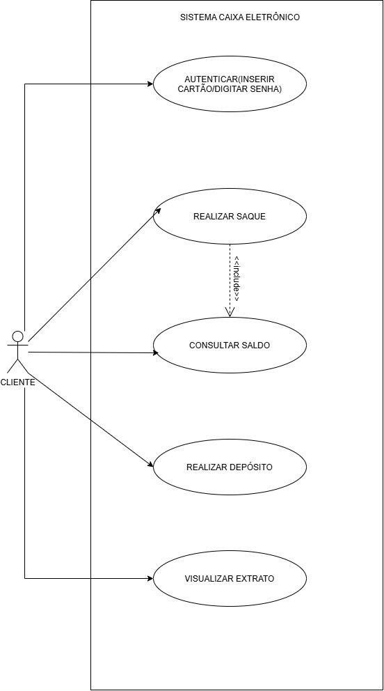

<details>
<summary>Versão em Mermaid (caso a imagem não abra)</summary>

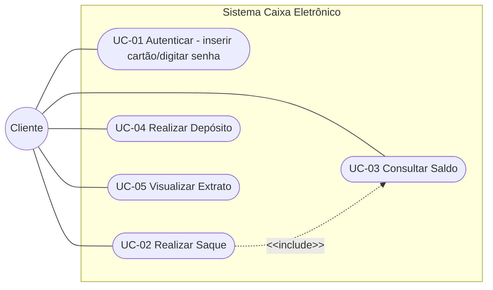

</details>

**Descrição dos atores**

| Ator | Descrição | Casos de uso associados |
|---|---|---|
| Cliente | Correntista do banco que utiliza o terminal ATM com cartão e PIN. | UC-01, UC-02, UC-03, UC-04, UC-05 |

**Lista de casos de uso**

| ID | Caso de uso | Ator(es) | Requisito(s) funcional(is) relacionado(s) |
|---|---|---|---|
| UC-01 | Autenticar (inserir cartão / digitar senha) | Cliente | RF-01 |
| UC-02 | Realizar Saque (`<<include>>` UC-03) | Cliente | RF-03, RF-06, RF-07, RF-08 |
| UC-03 | Consultar Saldo | Cliente | RF-04 |
| UC-04 | Realizar Depósito | Cliente | RF-02, RF-06, RF-07 |
| UC-05 | Visualizar Extrato | Cliente | RF-05 |

---

### 6.2 Visão arquitetural
O sistema adota a arquitetura **Cliente/Servidor em camadas**:

- **Cliente (Terminal ATM)** — camada de apresentação (`TerminalATM`, objeto de fronteira no diagrama de sequência, implementado pelas telas JavaFX e seus controllers). Coleta cartão, PIN e valores, exibe menus, respostas, comprovantes e extrato (a liberação de cédulas e a impressão são simuladas por mensagens na tela). **Não contém regra de negócio.**
- **Servidor** — camada de controle/serviço (`ContaService`, objeto de controle), camada de domínio (`Cliente`, `Conta`, `Transacao`, `TipoTransacao`) e camada de persistência (`ClienteDAO`, `ContaDAO`, `TransacaoDAO` e `OperacaoLogDAO`, representados por `DAOs` no diagrama de sequência).
- **Comunicação** — requisição/resposta com token de sessão e códigos de status HTTP (`200 OK`, `401`/`403` e `409 Erro` no diagrama de sequência; o servidor também usa 400, 401, 403, 404, 405 e 500).

Os padrões de projeto (seção 6.9) atuam em partes diferentes dessa arquitetura:

- **Proxy (cliente):** o `ContaServiceProxy` representa o servidor dentro do terminal. As telas chamam a interface `ContaBancariaService` como se o serviço fosse local; o proxy cuida do HTTP/JSON, do token e da sessão.
- **Command (servidor):** cada operação de conta (saque, depósito, saldo, extrato) é um objeto criado pelo `ApiController` e executado pelo `ContaService`, que controla a transação do banco e registra a operação em `operacao_log`.
- **Singleton (cliente e servidor):** `Configuracao`, `ConexaoBD` e `SessaoService` no servidor, e `Sessao` no terminal, têm instância única, compartilhada por todas as partes que as usam.

### 6.3 Diagrama de arquitetura (visão geral)

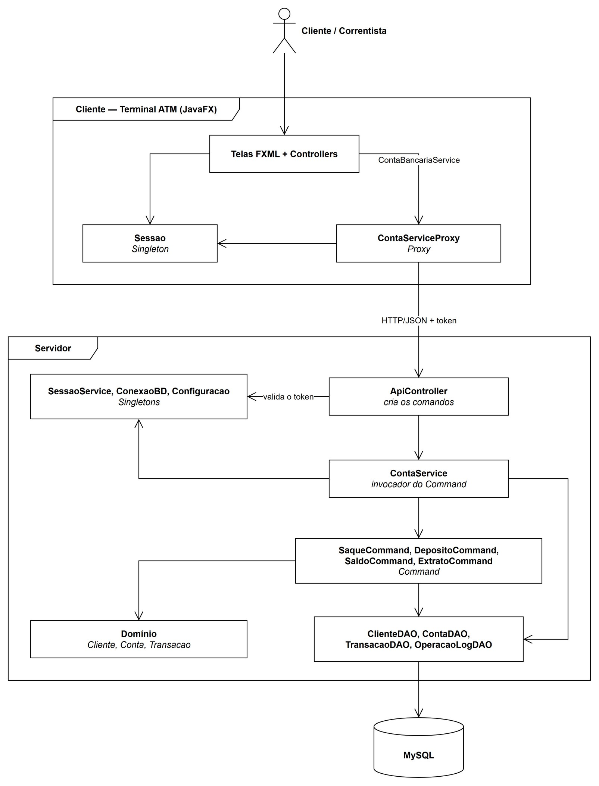

<details>
<summary>Versão em Mermaid (caso a imagem não abra)</summary>

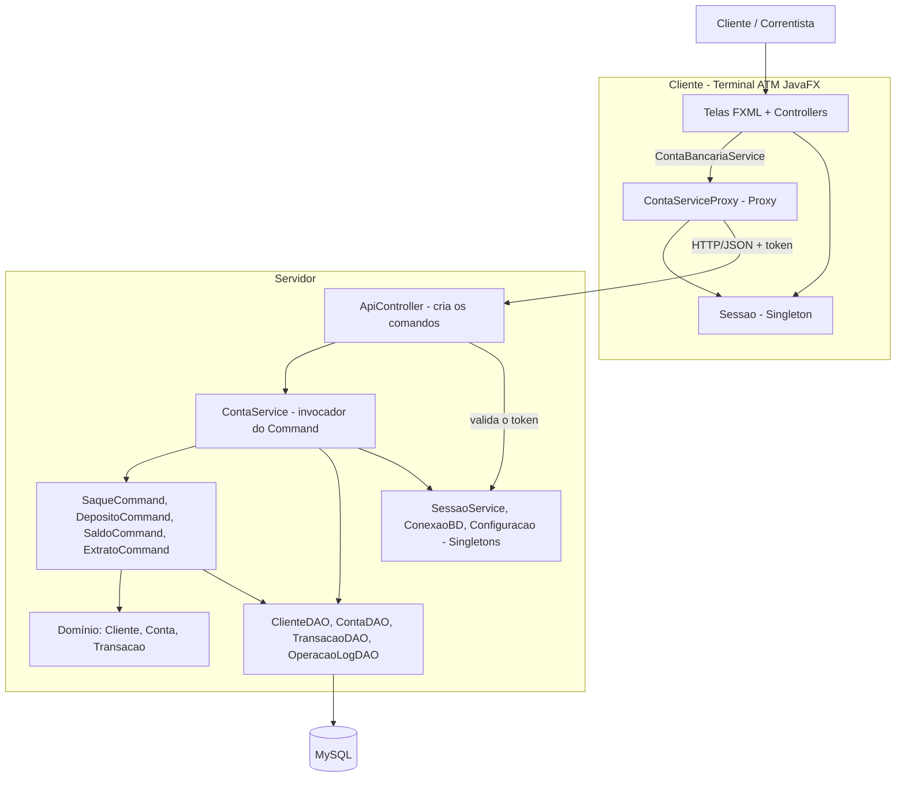

</details>

### 6.4 Componentes / Módulos

| Componente | Responsabilidade | Tecnologia |
|---|---|---|
| Terminal ATM (cliente) | Telas FXML e controllers: coleta cartão, PIN e valores, exibe menus, comprovantes e extrato; liberação de cédulas e impressão simuladas | Java + JavaFX |
| ContaServiceProxy (cliente) | Proxy: comunicação HTTP/JSON, envio do token, controle da sessão (`Sessao`) e tratamento de falha de conexão | Java + HttpClient |
| ApiController (servidor) | Recebe as requisições HTTP, valida o token e cria o comando de cada rota | Java (HttpServer do JDK) |
| ContaService (servidor) | Autenticação, validação de PIN, bloqueio do cartão e execução dos comandos (invocador), com transação e log | Java |
| Comandos (servidor) | `SaqueCommand`, `DepositoCommand`, `SaldoCommand`, `ExtratoCommand` | Java |
| Modelo de domínio | `Cliente`, `Conta`, `Transacao`, `TipoTransacao` | Java |
| DAOs | `ClienteDAO`, `ContaDAO`, `TransacaoDAO`, `OperacaoLogDAO`; conexões obtidas do `ConexaoBD` (Singleton) | Java + JDBC |
| Banco de Dados | Armazenamento persistente | MySQL 8 |

### 6.5 Stack tecnológica

| Camada | Tecnologia / Ferramenta | Versão |
|---|---|---|
| Linguagem | Java (cliente e servidor compilados com `release` 25) | JDK 25 ou superior |
| Front-end (terminal ATM) | JavaFX com telas FXML (Scene Builder) e `HttpClient` do JDK | JavaFX 25.0.5 |
| Back-end | `HttpServer` do JDK (API REST/JSON) e Gson | Gson 2.13.2 |
| Banco de Dados | MySQL via JDBC (mysql-connector-j) | MySQL 8.0; conector 9.4.0 |
| Testes | JUnit 5 (unidade, integração e sistema); Maven Surefire (`mvn test`) e Failsafe (`mvn verify`) | JUnit 5.13.4; Surefire e Failsafe 3.5.4 |
| Build | Maven multi-módulo (`atm-servidor`, `atm-cliente` e `atm-testes-sistema`), executado pelo NetBeans | javafx-maven-plugin 0.0.8; exec-maven-plugin 3.5.1 |
| IDE | Apache NetBeans | — |
| Infraestrutura / CI/CD | Execução local (servidor, cliente e MySQL na mesma máquina); sem CI/CD | — |

### 6.6 Modelo de dados

> Script em `banco/schema.sql`. Valores monetários em `DECIMAL(15,2)` (no Java, `BigDecimal`).

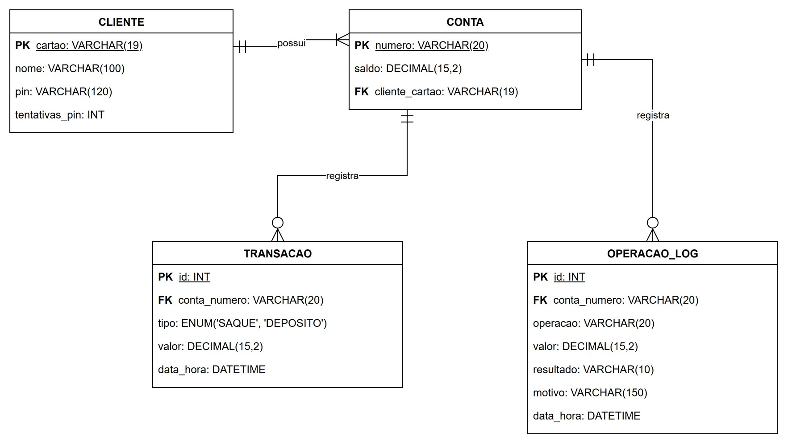

<details>
<summary>Versão em Mermaid (caso a imagem não abra)</summary>

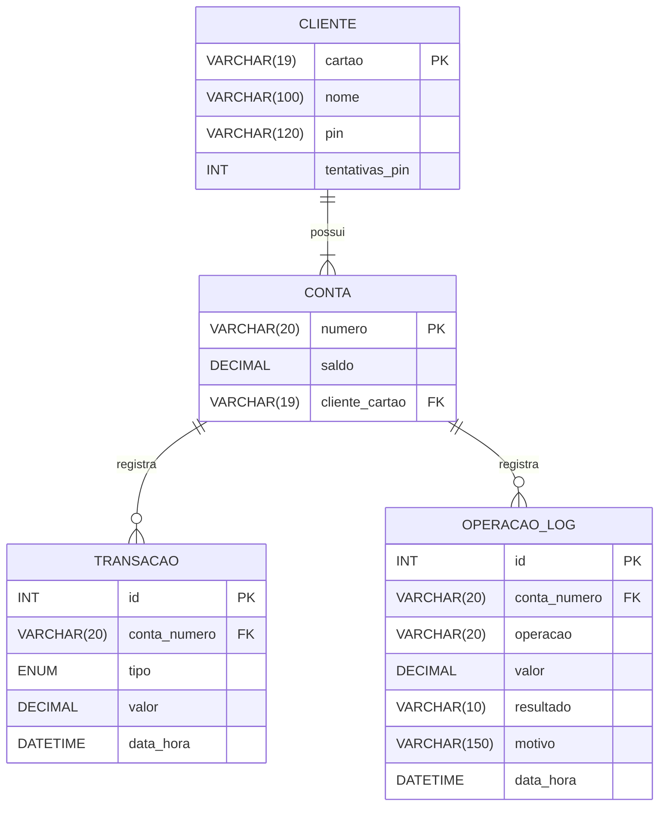

</details>

### 6.7 Diagrama de classes

**Diagrama do model (draw.io)**

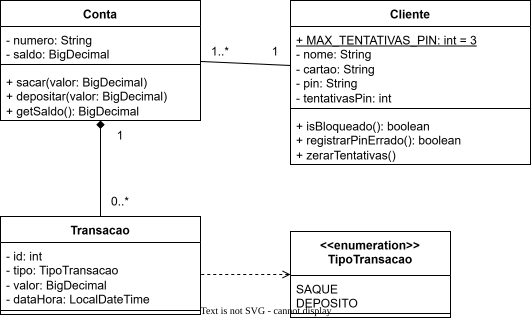

> Atualizado conforme o código: valores em `BigDecimal` (RN-09), data em `LocalDateTime` e controle de PINs errados em `Cliente` (RN-07).

<details>
<summary>Versão em Mermaid (caso a imagem não abra)</summary>

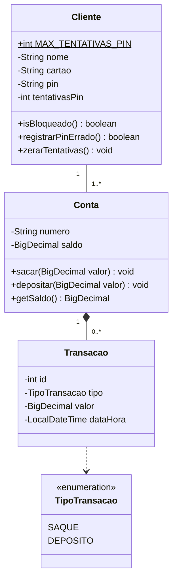

</details>

**Descrição das principais classes**

| Classe | Responsabilidade | Requisito(s) relacionado(s) |
|---|---|---|
| Cliente | Representa o correntista: nome, cartão, PIN (hash) e contador de PINs errados; aplica a regra de bloqueio. | RF-01, RN-06, RN-07 |
| Conta | Mantém o saldo e aplica as regras de saque e depósito. | RF-02, RF-03, RF-04, RN-01, RN-02, RN-09 |
| Transacao | Registro de cada operação (tipo, valor, data/hora). | RF-06, RN-04 |
| TipoTransacao | Enumeração dos tipos de transação (SAQUE, DEPOSITO). | RN-05 |
| ApiController | Recebe as requisições HTTP, valida o token e cria o comando de cada rota (Client do Command). | RN-03, RNF-07 |
| ContaService | Serviço real no servidor: autentica e executa os comandos (Invoker do Command), com transação do banco e log. | RF-01 a RF-06, RNF-03, RNF-09 |
| OperacaoCommand e concretos | Cada operação de conta como um objeto: saque, depósito, saldo e extrato. | RF-02 a RF-05 |
| SessaoService, ConexaoBD, Configuracao | Singletons do servidor: sessões, acesso ao MySQL e configuração. | RN-03, RNF-02 |
| ClienteDAO, ContaDAO, TransacaoDAO, OperacaoLogDAO | Persistência de clientes, contas, transações e log de operações. | RF-01, RF-05, RF-06, RNF-09 |
| ContaBancariaService | Interface usada pelas telas do terminal (Subject do Proxy). | RF-01 a RF-05 |
| ContaServiceProxy | Representante do servidor no terminal: HTTP/JSON, token e controle da sessão (Proxy). | RN-03, RNF-07 |
| Sessao | Singleton do terminal: usuário, token e conta selecionada. | RF-01, RN-03 |

---

### 6.8 Diagrama de sequência

**Diagrama de sequência — UC-01, UC-02, UC-03, UC-04 e UC-05 (RF-01 a RF-08)**

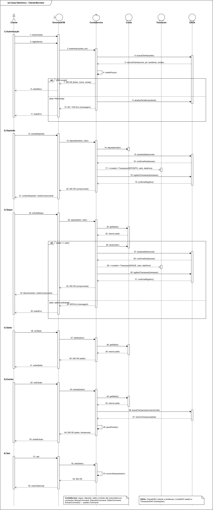

> No diagrama, `ContaService` representa também os comandos que executam cada operação (`SaqueCommand`, `DepositoCommand`, `SaldoCommand`, `ExtratoCommand`), e `DAOs` representa `ClienteDAO`, `ContaDAO` e `TransacaoDAO`.

<details>
<summary>Versão em Mermaid (caso a imagem não abra)</summary>

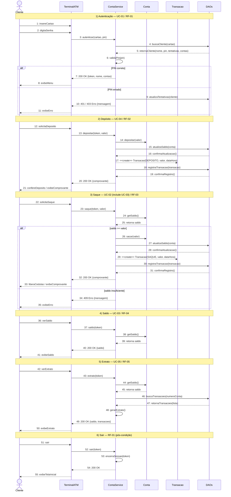

</details>

---

### 6.9 Padrões de projeto (GoF) utilizados

| Padrão GoF | Categoria | Problema que resolve no projeto | Classes / arquivos envolvidos |
|---|---|---|---|
| Singleton | Criacional | Garantir uma única instância compartilhada dos objetos que guardam estado comum: configuração, acesso ao banco e sessões no servidor, e os dados do usuário no terminal. | `Configuracao`, `ConexaoBD`, `SessaoService` (servidor); `Sessao` (cliente) |
| Command | Comportamental | Transformar cada operação de conta em um objeto, executado sempre da mesma forma pelo `ContaService`: dentro de uma transação do banco e com registro em log. | `OperacaoCommand`, `MovimentacaoCommand`, `SaqueCommand`, `DepositoCommand`, `SaldoCommand`, `ExtratoCommand`, `ContaService`, `ApiController` |
| Proxy | Estrutural | Esconder das telas do terminal a rede, o JSON, o token e o controle da sessão: elas chamam o serviço como se ele fosse local. | `ContaBancariaService`, `ContaServiceProxy`, `Sessao` (cliente); `ContaService` (servidor) |

Os três padrões cobrem as três categorias do GoF: criacional, comportamental e estrutural.

#### Padrão 1 — Singleton

- **Categoria:** Criacional
- **Intenção do padrão:** garantir que uma classe tenha uma única instância e fornecer um ponto global de acesso a ela.
- **Motivação / contexto no projeto:** várias partes do sistema precisam enxergar o mesmo estado. O token criado no login pelo `ContaService` é conferido em cada operação pelo `ApiController`: se cada um tivesse o seu `SessaoService`, o token não seria encontrado e o cliente receberia "Sessão expirada" logo depois de entrar. Da mesma forma, a `Configuracao` é lida uma única vez, todos os DAOs usam os mesmos dados de acesso do `ConexaoBD` e, no terminal, todas as telas precisam ver a mesma `Sessao` (usuário, token e conta selecionada).
- **Alternativas consideradas:** criar os objetos no `ServidorMain` e repassá-los pelos construtores (como era a primeira versão do código). Funciona, mas nada impede que alguém escreva `new SessaoService()` em outro lugar; com o Singleton, a instância única é garantida pelo próprio código.
- **Participantes (mapeamento para o projeto):**

  | Papel no padrão | Classe no projeto |
  |---|---|
  | Singleton | `Configuracao`, `ConexaoBD`, `SessaoService` (servidor); `Sessao` (cliente) |
  | Ponto de acesso global | método estático `getInstancia()` |
  | Construtor privado | impede `new` fora da própria classe |
  | Clientes | `ServidorMain`, `ApiController`, `ContaService` (servidor); `ContaServiceProxy` e controllers das telas (cliente) |

- **Diagrama de classes do padrão:**

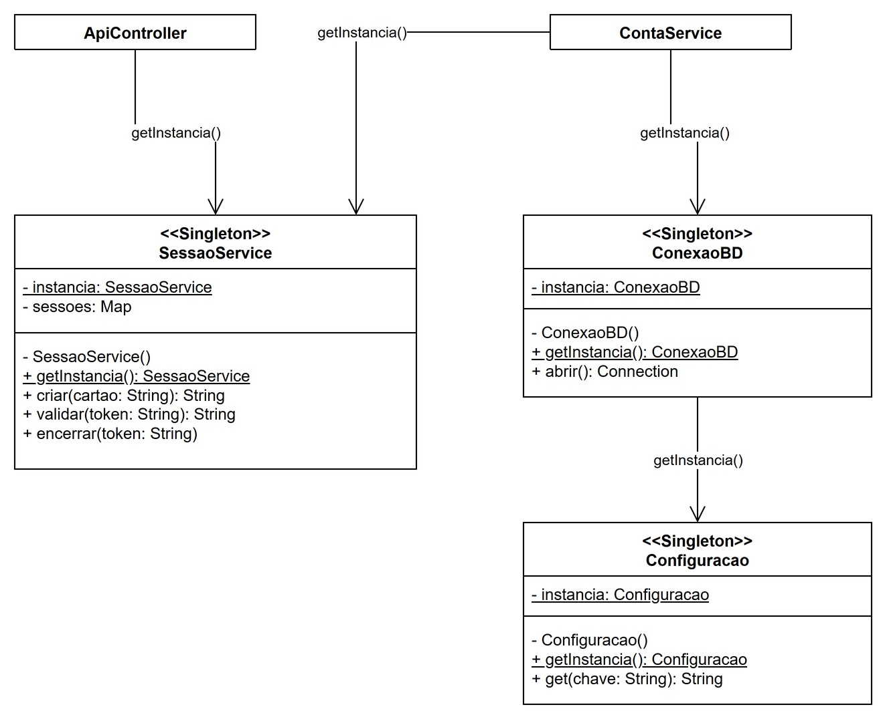

<details>
<summary>Versão em Mermaid (caso a imagem não abra)</summary>

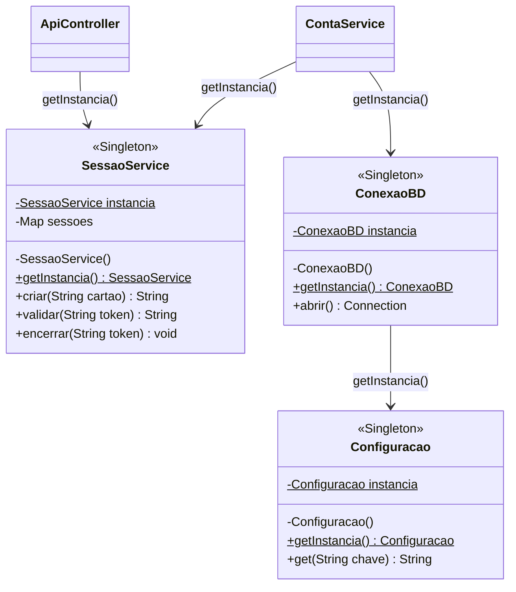

</details>

- **Trecho de código (`SessaoService`):**

```java
public final class SessaoService {

    private static SessaoService instancia;          // 1) campo estático com a instância única

    private SessaoService() {                         // 2) construtor privado: ninguém usa new
    }

    // 3) ponto de acesso global; synchronized porque o servidor atende várias requisições ao mesmo tempo
    public static synchronized SessaoService getInstancia() {
        if (instancia == null) {
            instancia = new SessaoService();
        }
        return instancia;
    }
}

// Uso: todos recebem o mesmo objeto
private final SessaoService sessoes = SessaoService.getInstancia();
```

- **Benefícios obtidos e consequências (trade-offs):** a instância única deixa de depender da disciplina de quem programa e passa a ser garantida pelo código; a criação só acontece quando a classe é usada pela primeira vez. Em troca, o Singleton é um estado global: dificulta testes isolados (os testes de `SessaoService` compartilham a mesma instância) e esconde dependências, que deixam de aparecer nos construtores. O `synchronized` evita que duas threads criem duas instâncias, com um custo pequeno a cada chamada.

#### Padrão 2 — Command

- **Categoria:** Comportamental
- **Intenção do padrão:** transformar uma solicitação em um objeto independente, que contém tudo o que é necessário para executá-la. Assim ela pode ser parametrizada, registrada em log, enfileirada ou desfeita.
- **Motivação / contexto no projeto:** na primeira versão, o `ContaService` tinha um método para cada operação e decidia entre saque e depósito com um `if (tipo == SAQUE) ... else ...`; cada método abria a conexão e tratava erros por conta própria, e não havia um ponto único para registrar as operações. Com o Command, cada operação de conta é uma classe, e o `ContaService.executar()` (invocador) trata todas da mesma forma: abre a transação do banco, busca a conta (travada com `FOR UPDATE` quando o comando altera o saldo), executa o comando, registra o resultado em `operacao_log` (`SUCESSO`, `RECUSADA` ou `ERRO`) e confirma ou desfaz tudo (RNF-03, RNF-09).
- **Sobre o `desfazer()`:** o GoF sugere um método `desfazer()` para estornar operações. Ele não foi implementado porque a própria transação do banco já desfaz tudo quando uma operação falha no meio. Um estorno depois de concluída a operação só seria necessário com hardware real (por exemplo, cédulas que não saem do dispensador), que está fora do escopo (seção 2.3).
- **Alternativas consideradas:** manter um `if`/`switch` no `ContaService` por tipo de operação. Cada nova operação (ex.: transferência) obrigaria a alterar esse método, e o log teria de ser repetido em cada caso.
- **Participantes (mapeamento para o projeto):**

  | Papel no padrão | Classe no projeto |
  |---|---|
  | Command | `OperacaoCommand<R>` (interface) |
  | ConcreteCommand | `SaqueCommand` e `DepositoCommand` (passos comuns em `MovimentacaoCommand`), `SaldoCommand`, `ExtratoCommand` (futuro: `TransferenciaCommand`) |
  | Client | `ApiController` (cria o comando de cada rota HTTP com os dados recebidos) |
  | Invoker | `ContaService.executar()` (executa qualquer comando com transação e log) |
  | Receiver | `Conta` (`sacar`, `depositar`, `getSaldo`) e os DAOs |

- **Diagrama de classes do padrão:**

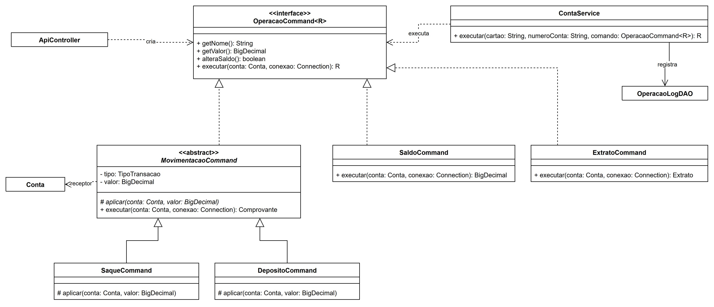

<details>
<summary>Versão em Mermaid (caso a imagem não abra)</summary>

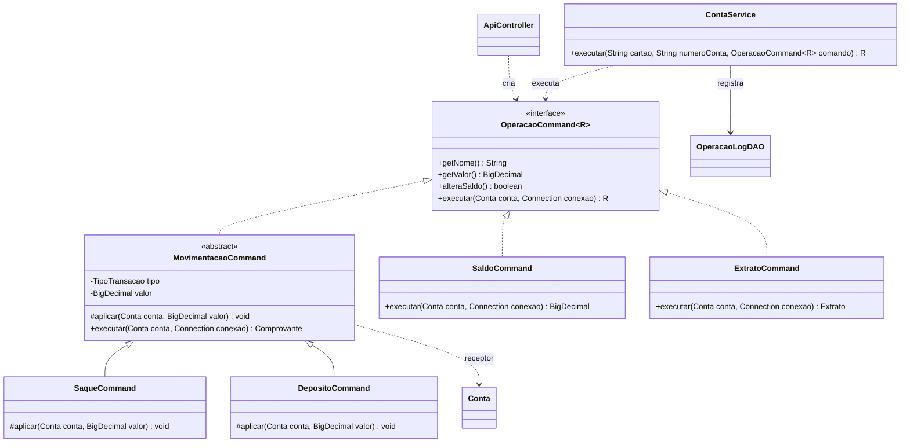

</details>

- **Trecho de código (simplificado):**

```java
// Client: o ApiController cria um comando para cada rota
return switch (operacao) {
    case "saque"    -> contaService.executar(cartao, numeroConta, new SaqueCommand(valor));
    case "deposito" -> contaService.executar(cartao, numeroConta, new DepositoCommand(valor));
    case "saldo"    -> Map.of("saldo", contaService.executar(cartao, numeroConta, new SaldoCommand()));
    default         -> contaService.executar(cartao, numeroConta, new ExtratoCommand());
};

// Invoker: o ContaService executa qualquer comando do mesmo jeito
public <R> R executar(String cartao, String numeroConta, OperacaoCommand<R> comando) throws SQLException {
    try (Connection conexao = banco.abrir()) {
        conexao.setAutoCommit(false);
        Conta conta = null;
        try {
            conta = exigirConta(comando.alteraSaldo()
                    ? contaDAO.buscarParaAtualizar(conexao, numeroConta, cartao)
                    : contaDAO.buscar(conexao, numeroConta, cartao));
            R resultado = comando.executar(conta, conexao);
            operacaoLogDAO.registraOperacao(conexao, numeroConta, comando.getNome(), comando.getValor(),
                    "SUCESSO", null);
            conexao.commit();
            return resultado;
        } catch (SQLException | RuntimeException e) {
            conexao.rollback();                       // desfaz tudo o que o comando fez
            if (conta != null) {
                registrarFalha(conexao, numeroConta, comando, e);   // RECUSADA ou ERRO no log
            }
            throw e;
        }
    }
}

// ConcreteCommand: o saque confere o saldo antes de sacar (RN-01)
public class SaqueCommand extends MovimentacaoCommand {
    @Override
    protected void aplicar(Conta conta, BigDecimal valor) {
        if (conta.getSaldo().compareTo(valor) < 0) {
            throw new SaldoInsuficienteException();
        }
        conta.sacar(valor);
    }
}
```

- **Benefícios obtidos e consequências (trade-offs):** novas operações entram como novas classes, sem alterar o invocador (princípio aberto/fechado); transação e log ficam em um único lugar, e passaram a ser registradas também as consultas e as operações recusadas. Em troca, há mais classes (uma por operação), e os passos comuns de saque e depósito precisaram ser reunidos em `MovimentacaoCommand` para não se repetirem.

#### Padrão 3 — Proxy

- **Categoria:** Estrutural
- **Intenção do padrão:** fornecer um substituto (representante) de outro objeto para controlar o acesso a ele. Quem usa o proxy não percebe a diferença.
- **Motivação / contexto no projeto:** o serviço real (`ContaService`) roda em outro programa, o servidor. As telas do terminal não devem lidar com HTTP, JSON, token nem sessão expirada. Elas chamam a interface `ContaBancariaService` como se o serviço fosse local, e o `ContaServiceProxy` faz dois tipos de controle:
  - **Proxy remoto:** monta a requisição HTTP, converte o JSON em objetos e trata a falta de conexão ("Não foi possível conectar ao servidor").
  - **Proxy de proteção:** só envia operações de conta com sessão ativa, anexa o token em cada pedido e encerra a sessão local (`Sessao`) quando o servidor responde que ela expirou (401) ou quando o cliente sai.
- **Contrato entre os dois lados:** cliente e servidor são projetos independentes, sem código em comum. Por isso a interface `ContaBancariaService` existe no cliente, e o contrato com o objeto real é a API HTTP do servidor (rotas `/api/...`, seção 6.12). No protótipo, a comunicação é HTTP sem TLS (ver RNF-L05).
- **Alternativas consideradas:** colocar o código HTTP diretamente nos controllers das telas. Isso misturaria interface e comunicação, espalharia o controle de sessão por várias telas (como acontecia na primeira versão, com a classe `AtmApi`) e impediria trocar o servidor por um dublê em testes.
- **Participantes (mapeamento para o projeto):**

  | Papel no padrão | Classe no projeto |
  |---|---|
  | Subject | `ContaBancariaService` (interface, no cliente) |
  | Proxy | `ContaServiceProxy` (no cliente) |
  | RealSubject | `ContaService` (no servidor, acessado pelas rotas do `ApiController`) |
  | Client | Controllers das telas (`LoginController`, `MenuController`, `ValorController`), por meio de `Navegador.servico()` |

- **Diagrama de classes do padrão:**

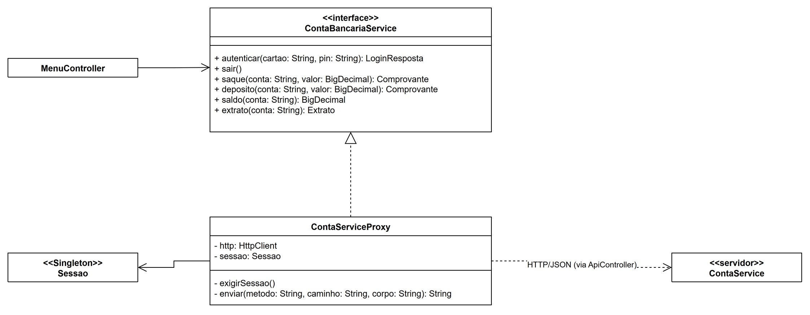

<details>
<summary>Versão em Mermaid (caso a imagem não abra)</summary>

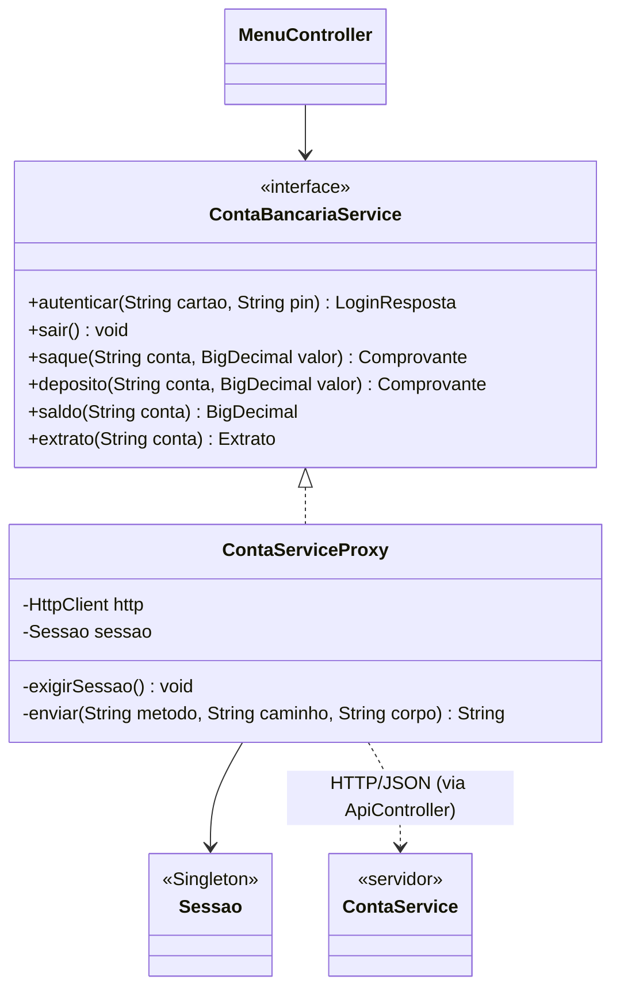

</details>

- **Trecho de código (`ContaServiceProxy`, simplificado):**

```java
public class ContaServiceProxy implements ContaBancariaService {

    @Override
    public Comprovante saque(String conta, BigDecimal valor) throws ApiException {
        exigirSessao();                                       // proxy de proteção
        String corpo = gson.toJson(Map.of("valor", valor));
        return gson.fromJson(enviar("POST", caminhoConta(conta, "saque"), corpo), Comprovante.class);
    }

    /** Sem sessão, a operação nem chega a ir para a rede. */
    private void exigirSessao() throws ApiException {
        if (!sessao.isAtiva()) {
            throw new ApiException(401, "Sessão expirada. Insira o cartão novamente.");
        }
    }

    private String enviar(String metodo, String caminho, String corpo) throws ApiException {
        // proxy remoto: monta o HTTP, anexa o token e trata a falta de conexão
        ...
        if (resposta.statusCode() == 401 && sessao.isAtiva()) {
            sessao.encerrar();                                // a sessão acabou no servidor
        }
        ...
    }
}

// Nas telas, a chamada parece local:
Navegador.servico().saque(conta, valor);
```

- **Benefícios obtidos e consequências (trade-offs):** os controllers das telas ficam independentes da rede e mais simples; o controle de acesso do terminal fica em um só lugar; e, em testes, o proxy pode ser trocado por qualquer implementação de `ContaBancariaService` (por exemplo, um serviço falso sem servidor). Em troca, há uma camada a mais e é preciso manter o proxy alinhado com as rotas da API do servidor.

---

### 6.10 Decisões de arquitetura (ADR resumido)

| ID | Decisão | Contexto | Alternativas consideradas | Justificativa |
|---|---|---|---|---|
| ADR-01 | Arquitetura cliente/servidor com terminal "magro" | Vários ATMs acessam as mesmas contas | Terminal com banco local sincronizado | Saldo com fonte única no servidor evita inconsistência e fraude |
| ADR-02 | Comunicação requisição/resposta com status HTTP e token | Diagrama de sequência usa 200, 401/403, 409 e token | Sockets com protocolo próprio | Padrão conhecido, fácil de testar e proteger com TLS |
| ADR-03 | Validação de PIN somente no servidor | Segurança (RN-07, RNF-02) | Validar no terminal | Terminal pode ser adulterado; PIN não deve ficar no cliente |
| ADR-04 | Operações como Commands executados pelo `ContaService` | Necessidade de log de auditoria e de um ponto único de transação | `if`/`switch` no serviço | Extensibilidade (nova operação = nova classe) e auditoria em `operacao_log` |
| ADR-05 | Acesso a dados via DAO | Separar regra de negócio de SQL | SQL direto no serviço | SQL concentrado nos DAOs: regras de negócio e comandos não conhecem o SQL, e uma troca de SGBD afeta só os DAOs |
| ADR-06 | Singleton para configuração, conexão e sessões | Sessões e configuração precisam ser as mesmas para todo o sistema | Criar os objetos no `ServidorMain` e repassá-los pelos construtores | A instância única passa a ser garantida pelo código |
| ADR-07 | Acesso ao servidor pelo `ContaServiceProxy` (Proxy) | As telas não devem conhecer HTTP, JSON e token | Código HTTP direto nos controllers | Telas mais simples, controle de sessão em um só lugar e possibilidade de dublê em testes |
| ADR-08 | Bloqueio do cartão como contador na classe `Cliente`, sem o padrão State | RN-07; estados de hardware fora do escopo | Padrão State no terminal | Com só dois estados (ativo e bloqueado), o State seria exagero |

### 6.11 Estrutura de pastas do projeto

```
/Projeto_Eng_Soft__Cliente_Servidor
  pom.xml                       Projeto Maven pai (módulos atm-servidor, atm-cliente e atm-testes-sistema)
  /banco
    schema.sql                  Tabelas, atualização de bancos antigos e dados de teste
  /atm-servidor
    /src/main/java/com/atm/servidor
      ServidorMain, Configuracao (Singleton)
      /controller   ApiController
      /service      ContaService (invocador do Command), SessaoService (Singleton), Senhas, ApiException
      /command      OperacaoCommand, MovimentacaoCommand, SaqueCommand, DepositoCommand, SaldoCommand, ExtratoCommand
      /model        Cliente, Conta, Transacao, TipoTransacao, Comprovante, Extrato, LoginResposta, SaldoInsuficienteException
      /dao          ConexaoBD (Singleton), ClienteDAO, ContaDAO, TransacaoDAO, OperacaoLogDAO
    /src/test/java/com/atm/servidor
      ConfiguracaoTest (TDD)
      /model        ContaTest, ClienteTest                          (unidade)
      /service      SessaoServiceTest                               (unidade)
      /integracao   ContaIntegracaoIT, ClienteIntegracaoIT, SessaoIntegracaoIT  (integração)
      /apoio        BancoDeTeste (cria o banco caixa_eletronico_teste)
  /atm-cliente
    /src/main/java/com/atm/cliente
      AtmApp
      /controller   Navegador, LoginController, MenuController, ValorController,
                    ComprovanteController, SaldoController, ExtratoController, Formatos
      /service      ContaBancariaService, ContaServiceProxy (Proxy), ApiException
      /model        Sessao (Singleton), Comprovante, Extrato, LoginResposta, Transacao, TipoTransacao
    /src/main/resources/com/atm/cliente/view
      Login.fxml, Menu.fxml, Valor.fxml, Comprovante.fxml, Saldo.fxml, Extrato.fxml, atm.css
  /atm-testes-sistema
    /src/test/java/com/atm/sistema
      ContaSistemaIT, ClienteSistemaIT, SessaoSistemaIT  (sistema)
      TerminalDeTeste (sobe o servidor de teste e usa as telas do terminal)
  /docs
    Documentacao_ClienteServidor_CaixaEletronico.md   Este documento
    /imagens                    Imagens dos diagramas usadas no documento
    /diagramas drawio           Arquivos editáveis dos diagramas (draw.io)
```

### 6.12 Integrações externas

| Sistema externo | Finalidade | Protocolo | Observações |
|---|---|---|---|
| Servidor do banco (ContaService) | Autenticação e operações de conta | HTTP (REST/JSON); TLS previsto no RNF-L05, ainda não implementado | Acessado pelo `ContaServiceProxy`; rotas `/api/autenticar`, `/api/sair` e `/api/contas/{numero}/saldo`, `/saque`, `/deposito`, `/extrato` |
| Hardware do ATM (leitora, teclado, dispensador, impressora) | Entrada/saída física | Drivers locais | Simulado no projeto acadêmico |
| Banco de dados (MySQL 8) | Persistência | JDBC/SQL | Acessado pelos DAOs, com conexões obtidas do `ConexaoBD` (Singleton) |

---

## 7. Plano e Casos de Teste

### 7.1 Estratégia de testes

Os testes seguem as três **etapas** vistas na disciplina, cada uma com uma **técnica**:

| Etapa | O que verifica | Técnica |
|---|---|---|
| **Unidade** | Uma classe sozinha, sem banco de dados nem rede | **Caixa branca**: o teste conhece a lógica interna da classe |
| **Integração** | A classe funcionando junto com as outras partes do servidor e com o MySQL | **Caixa cinza**: o teste conhece a estrutura e confere o que ficou gravado no banco |
| **Sistema** | O sistema completo, pelas telas do terminal, como o cliente usaria | **Caixa preta**: o teste só digita, clica e lê o que aparece na tela |

Foram escolhidas **três classes** do sistema, e cada uma é testada nas três etapas:

| Classe testada | Classe de teste (JUnit) | Cenários cobertos | Requisito(s) / Regra(s) relacionado(s) | Resultado |
|---|---|---|---|---|
| `Conta`: mantém o saldo e aplica as regras de saque e depósito | `ContaTest` (unidade) | Saque diminui o saldo; saque de todo o saldo (valor limite); saque acima do saldo é recusado e o saldo não muda (erro) | RF-03, RN-01, RN-09 | 3/3 aprovados |
| | `ContaIntegracaoIT` (integração) | Depósito grava saldo, transação e log; saque acima do saldo não altera o banco; depósito de valor zero ou negativo é recusado; falha no meio do saque desfaz tudo | RF-02, RF-03, RF-06, RN-01, RN-02, RN-04, RNF-03, RNF-09 | 4/4 aprovados |
| | `ContaSistemaIT` (sistema) | Saque mostra o comprovante; tela de saldo; extrato com o saldo após cada transação e as cores | RF-03, RF-04, RF-05, RF-07, RN-08 | 3/3 aprovados |
| `Cliente`: dados do correntista e regra de bloqueio do cartão | `ClienteTest` (unidade) | Bloqueia na 3ª senha errada; acertar a senha zera as tentativas | RN-07 | 2/2 aprovados |
| | `ClienteIntegracaoIT` (integração) | Login devolve token, nome e contas; o 3º PIN errado bloqueia o cartão no banco | RF-01, RN-07 | 2/2 aprovados |
| | `ClienteSistemaIT` (sistema) | Login abre o menu; 3 senhas erradas bloqueiam o cartão | RF-01, RF-08, RN-07 | 2/2 aprovados |
| `SessaoService`: cria, valida e encerra os tokens de sessão (Singleton) | `SessaoServiceTest` (unidade) | Instância única (Singleton); token vale até a sessão ser encerrada | RN-03 | 2/2 aprovados |
| | `SessaoIntegracaoIT` (integração) | Sem token, 401; o token vale até o cliente sair | RN-03 | 2/2 aprovados |
| | `SessaoSistemaIT` (sistema) | Sair volta à tela inicial; sessão expirada volta ao login com aviso | RF-01, RF-08, RN-03 | 2/2 aprovados |

**Recursos do JUnit utilizados:** `@Test` e `@DisplayName` em todos os casos; `@BeforeEach` para recriar o banco de teste antes de cada caso; `@BeforeAll` e `@AfterAll` para preparar e desligar o servidor e o terminal de teste; `@AfterEach` no `ConfiguracaoTest`. Verificações com `assertEquals`, `assertThrows`, `assertTrue`, `assertFalse`, `assertSame`, `assertNotNull` e `assertArrayEquals`. Não foram usados mocks: os testes de integração e de sistema usam o banco de teste e o servidor reais.

**Ferramentas:** JUnit 5 nas três etapas (os slides usam Jest em TypeScript; o JUnit é o equivalente em Java). Os testes de integração e de sistema usam um banco separado, `caixa_eletronico_teste`, recriado antes de cada caso, para não alterar os dados do banco `caixa_eletronico`.

**Como executar:**
- Só os testes de unidade (sem MySQL): `mvn test`, ou o botão **Test** do NetBeans.
- Todos os testes: `mvn verify`, ou no NetBeans **Run Maven > Testes completos (verify)**.

**Exemplo de teste de unidade (`ContaTest`):**

```java
@Test
@DisplayName("Saque acima do saldo é recusado e o saldo não muda")
void sacarMaisQueOSaldoFalhaESaldoNaoMuda() {
    assertThrows(SaldoInsuficienteException.class, () -> conta.sacar(new BigDecimal("100.01")));
    assertEquals(new BigDecimal("100.00"), conta.getSaldo());
}
```

**TDD.** Para os testes usarem o banco e o servidor de teste, duas linhas do código passaram a aceitar configurações passadas na execução (`-Dchave=valor`): uma em `Configuracao` (servidor) e outra em `ContaServiceProxy` (terminal). Sem essas configurações, o sistema funciona como antes. A mudança seguiu o ciclo **RED → GREEN → REFACTOR**: primeiro foi escrito o `ConfiguracaoTest`, que falhou (*expected: <9999> but was: <8080>*); depois foi feita a mudança mínima, e o teste passou.

**Resultado (20/11/2026):** 24 casos executados, 24 aprovados (9 de unidade, 8 de integração e 7 de sistema).

### 7.2 Ambientes de teste

| Ambiente | Finalidade | URL / Acesso |
|---|---|---|
| Desenvolvimento | Testes de unidade, sem banco de dados | IDE (**Test**) / `mvn test` |
| Integração e sistema | Testes de integração e de sistema com MySQL local; o servidor de teste sobe em uma porta livre de `127.0.0.1` | IDE (**Run Maven > Testes completos (verify)**) / `mvn verify`; banco `caixa_eletronico_teste` |
| Uso manual | Uso e demonstração do sistema pelo terminal | Servidor em `http://localhost:8080`; banco `caixa_eletronico` |
| Produção | Terminais reais conectados ao servidor do banco | [não aplicável no projeto acadêmico] |

### Convenção de ID
`CT-XX` (Caso de Teste número XX)

### 7.3 Casos de Teste

> Os dados de partida são os do `banco/schema.sql`: Maria (cartão 1111222233334444, PIN 1234) com a conta 0001-1 (R$ 1.000,00) e a conta 0001-2 (R$ 250,00). Todos os casos são executados pelos testes automatizados da seção 7.1.

| ID | Requisito relacionado | Descrição / Cenário | Pré-condições | Passos | Resultado esperado | Status |
|---|---|---|---|---|---|---|
| CT-01 | RF-01 | Autenticação com cartão e PIN válidos | Cliente cadastrado | 1. Informar o cartão 2. Digitar o PIN correto | Token gerado; menu exibido com "Olá, Maria Silva" e as contas do cliente | Aprovado |
| CT-02 | RF-01, RN-07 | Autenticação com PIN inválido | Cliente cadastrado | 1. Informar o cartão 2. Digitar o PIN errado | "Cartão ou senha inválidos" (401); sem token; tentativa gravada | Aprovado |
| CT-03 | RF-02, RF-06 | Depósito válido | Autenticado; saldo R$ 1.000,00 | 1. Depositar R$ 50,00 | Saldo R$ 1.050,00; uma transação DEPOSITO; log SUCESSO; comprovante | Aprovado |
| CT-04 | RF-02, RN-02 | Depósito com valor zero ou negativo | Autenticado | 1. Depositar R$ 0 / −R$ 10 | Operação recusada (400); saldo inalterado; nenhuma transação | Aprovado |
| CT-05 | RF-03, RF-07, RN-01 | Saque com saldo suficiente | Autenticado; saldo R$ 1.000,00 | 1. Sacar R$ 100,00 | Saldo R$ 900,00; transação SAQUE; comprovante com "Retire suas cédulas e o comprovante." | Aprovado |
| CT-06 | RF-03, RN-01 | Saque com saldo insuficiente | Autenticado; saldo R$ 1.000,00 | 1. Sacar R$ 1.000,01 | "Saldo insuficiente"; saldo R$ 1.000,00; nenhuma transação; log RECUSADA | Aprovado |
| CT-07 | RF-03, RN-01 | Saque igual ao saldo (valor limite) | Autenticado; saldo R$ 1.000,00 | 1. Sacar R$ 1.000,00 | Saldo R$ 0,00; saque aprovado | Aprovado |
| CT-08 | RF-04 | Consulta de saldo | Autenticado | 1. Escolher "Saldo" | Tela mostra "Conta 0001-1" e R$ 1.000,00, igual ao saldo gravado | Aprovado |
| CT-09 | RF-05, RN-08 | Extrato com transações | Autenticado; conta sem transações | 1. Depositar R$ 100,00 2. Sacar R$ 30,00 3. Escolher "Extrato" | Saldo R$ 1.070,00; 2 transações, da mais recente para a mais antiga, com o saldo após cada uma; depósito em azul e saque em vermelho | Aprovado |
| CT-10 | RN-03 | Operação sem token | Sem autenticação | 1. Consultar o saldo sem token | Operação recusada (401) | Aprovado |
| CT-11 | RF-01, RF-08, RN-07 | Bloqueio após 3 PINs inválidos | Cliente cadastrado | 1. Digitar PIN errado 3 vezes 2. Digitar o PIN correto | "Cartão bloqueado após 3 senhas incorretas. Procure sua agência."; o PIN correto também é recusado (403); `tentativas_pin` = 3 | Aprovado |
| CT-12 | RNF-03 | Falha no servidor durante o saque | Autenticado; saldo R$ 1.000,00 | 1. Sacar R$ 40,00 com uma falha simulada depois de o saldo e a transação serem gravados | Transação do banco desfeita (rollback); saldo inalterado; operação registrada como ERRO em `operacao_log` | Aprovado |
| CT-13 | RF-06, RN-04 | Transação registrada uma única vez | Autenticado | 1. Depositar R$ 50,00 | Exatamente 1 transação nova | Aprovado |
| CT-14 | RF-01, RN-03 | Sair encerra a sessão | Autenticado | 1. Clicar em "Sair" 2. Tentar usar o mesmo token | Terminal volta à tela de cartão e senha; o token deixa de valer (401) | Aprovado |
| CT-15 | RF-08, RN-03 | Sessão expirada | Autenticado; sessão expirada no servidor | 1. Escolher "Saldo" | Terminal volta à tela inicial com "Sessão expirada. Insira o cartão novamente." | Aprovado |

---

## 8. Matriz de Rastreabilidade (Requisitos x Testes x Código-fonte)

> Objetivo: garantir que todo requisito tenha teste(s) associado(s) e implementação identificável no código-fonte, permitindo análise de cobertura e impacto de mudanças.

| Requisito (RF/RNF/RN) | Descrição resumida | Caso(s) de Teste | Arquivo(s) / Módulo de código | Status de implementação | Status de teste |
|---|---|---|---|---|---|
| RF-01 | Autenticar com cartão + PIN | CT-01, CT-02, CT-11, CT-14 | servidor: `service/ContaService.java`, `model/Cliente.java`; cliente: `controller/LoginController.java` | Concluído | Aprovado |
| RF-02 | Depósito | CT-03, CT-04 | servidor: `model/Conta.java`, `command/DepositoCommand.java` | Concluído | Aprovado |
| RF-03 | Saque | CT-05, CT-06, CT-07 | servidor: `model/Conta.java`, `command/SaqueCommand.java` | Concluído | Aprovado |
| RF-04 | Consultar saldo | CT-08 | servidor: `command/SaldoCommand.java` | Concluído | Aprovado |
| RF-05 | Extrato | CT-09 | servidor: `command/ExtratoCommand.java`, `dao/TransacaoDAO.java`; cliente: `controller/ExtratoController.java` | Concluído | Aprovado |
| RF-06 | Registrar transação | CT-03, CT-13 | servidor: `command/MovimentacaoCommand.java`, `model/Transacao.java`, `dao/TransacaoDAO.java` | Concluído | Aprovado |
| RF-07 | Emitir comprovante | CT-05 | cliente: `controller/ComprovanteController.java`, `view/Comprovante.fxml` | Concluído | Aprovado |
| RF-08 | Exibir erro | CT-11, CT-15 | cliente: `controller/Navegador.java`, `controller/LoginController.java`, `controller/ValorController.java` | Concluído | Aprovado |
| RN-01 | Saldo ≥ valor para sacar | CT-05, CT-06, CT-07 | servidor: `command/SaqueCommand.java`, `model/Conta.java` | Concluído | Aprovado |
| RN-02 | Valor > 0 | CT-04 | servidor: `command/MovimentacaoCommand.java`, `model/Conta.java` | Concluído | Aprovado |
| RN-03 | Token obrigatório | CT-10, CT-14, CT-15 | cliente: `service/ContaServiceProxy.java`; servidor: `service/SessaoService.java`, `controller/ApiController.java` | Concluído | Aprovado |
| RN-04 | Uma transação por operação | CT-13 | servidor: `command/MovimentacaoCommand.java`, `dao/TransacaoDAO.java` | Concluído | Aprovado |
| RN-07 | Bloqueio após 3 PINs inválidos | CT-02, CT-11 | servidor: `model/Cliente.java`, `service/ContaService.java`, `dao/ClienteDAO.java` | Concluído | Aprovado |
| RN-08 | Ordem do extrato e saldo após cada transação | CT-09 | cliente: `controller/ExtratoController.java`; servidor: `dao/TransacaoDAO.java` | Concluído | Aprovado |
| RNF-02 | PIN com hash / token | CT-01, CT-10 | servidor: `service/Senhas.java` (PBKDF2), `service/SessaoService.java` | Concluído | Aprovado |
| RNF-03 | Tolerância a falhas (transação do banco) | CT-06, CT-12 | servidor: `service/ContaService.java` (`executar`: commit/rollback) | Concluído | Aprovado |
| RNF-09 | Registro de operações (auditoria) | CT-03, CT-06 | servidor: `service/ContaService.java`, `dao/OperacaoLogDAO.java` | Concluído | Aprovado |
| RNF-L05 | PIN com hash; sem PIN no terminal | CT-01, CT-10 | servidor: `service/Senhas.java`, `banco/schema.sql`; cliente: `model/Sessao.java` | Concluído (TLS fica para implantação real) | Aprovado |

**Legenda — Status de implementação:** Não iniciado / Em desenvolvimento / Concluído / Bloqueado
**Legenda — Status de teste:** Pendente / Em execução / Aprovado / Reprovado

> Status de teste conforme a execução de 20/11/2026 (seção 7.1).

---

## 9. Glossário

| Termo | Definição |
|---|---|
| ATM | *Automated Teller Machine* — caixa eletrônico (terminal de autoatendimento). |
| PIN | *Personal Identification Number* — senha numérica do cartão. |
| Token de sessão | Identificador temporário emitido após a autenticação e enviado em cada operação. |
| Transação | Registro de uma operação de saque ou depósito com tipo, valor e data/hora. |
| Extrato | Relatório com o saldo e o histórico de transações da conta. |
| Comprovante | Tela que confirma um saque ou depósito (simula o comprovante impresso). |
| DAO | *Data Access Object* — classe responsável pelo acesso ao banco de dados. |
| Cliente/Servidor | Arquitetura em que o cliente (terminal) solicita serviços a um servidor central. |
| Códigos HTTP | 200 sucesso; 400 valor ou pedido inválido; 401 cartão/senha inválidos ou sessão expirada; 403 cartão bloqueado; 404 conta ou rota inexistente; 405 método não permitido; 409 saldo insuficiente; 500 erro interno. |
| Teste de unidade | Teste de uma classe ou método isolado, sem banco de dados nem rede. |
| Teste de integração | Teste de várias partes funcionando juntas (aqui, servidor, DAOs e MySQL). |
| Teste de sistema | Teste do sistema completo do ponto de vista do usuário, pela interface. |
| Caixa branca / preta / cinza | Técnicas de teste: com conhecimento do código interno (branca), só pelo comportamento (preta) ou com conhecimento parcial da estrutura (cinza). |
| TDD | *Test-Driven Development* — escrever o teste antes do código, no ciclo RED → GREEN → REFACTOR. |
| GoF | *Gang of Four* — autores do catálogo clássico de 23 padrões de projeto. |
| LGPD | Lei Geral de Proteção de Dados (Lei nº 13.709/2018). |

---

## 10. Anexos e Referências

- Diagrama de casos de uso — Sistema Caixa Eletrônico (imagem).
- Diagrama de classes do model — `diagrama de classe model cliente servidor - atualizado.drawio` (imagem em `imagens/classesCS_atualizado.svg`).
- Diagrama de sequência — `Diagrama de sequencia ClienteServidor - atualizado.drawio` (imagem em `imagens/sequenciaCS_atualizado.jpg`).
- Diagrama de arquitetura — `Diagrama de arquitetura ClienteServidor.drawio` (imagem em `imagens/arquiteturaCS.jpg`).
- Modelo de dados — `Diagrama modelo de dados ClienteServidor.drawio` (imagem em `imagens/modeloDadosCS.jpg`).
- Diagramas de classe dos padrões — `Diagrama padrao Singleton/Command/Proxy ClienteServidor.drawio` (imagens em `imagens/padraoSingletonCS.jpg`, `imagens/padraoCommandCS.jpg` e `imagens/padraoProxyCS.jpg`).
- Link para protótipos / wireframes: não se aplica (as telas estão nos arquivos FXML do módulo `atm-cliente`).
- Link para repositório de código: [https://github.com/KeteliLino/Projeto_Eng_Soft__Cliente_Servidor]
- Link para backlog / board: [não se aplica]
- Documentos de referência:
  - GAMMA, E.; HELM, R.; JOHNSON, R.; VLISSIDES, J. *Padrões de Projeto: soluções reutilizáveis de software orientado a objetos*. Bookman.
  - ISO/IEC 25010 — Systems and software Quality Requirements and Evaluation (SQuaRE).
  - Lei nº 13.709/2018 — Lei Geral de Proteção de Dados Pessoais (LGPD).
  - ZOTOVICI, A. *Testes de Software* (slides da disciplina de Engenharia de Software III, Fatec).
  - Documentação do JUnit 5 e do Maven Failsafe Plugin.
